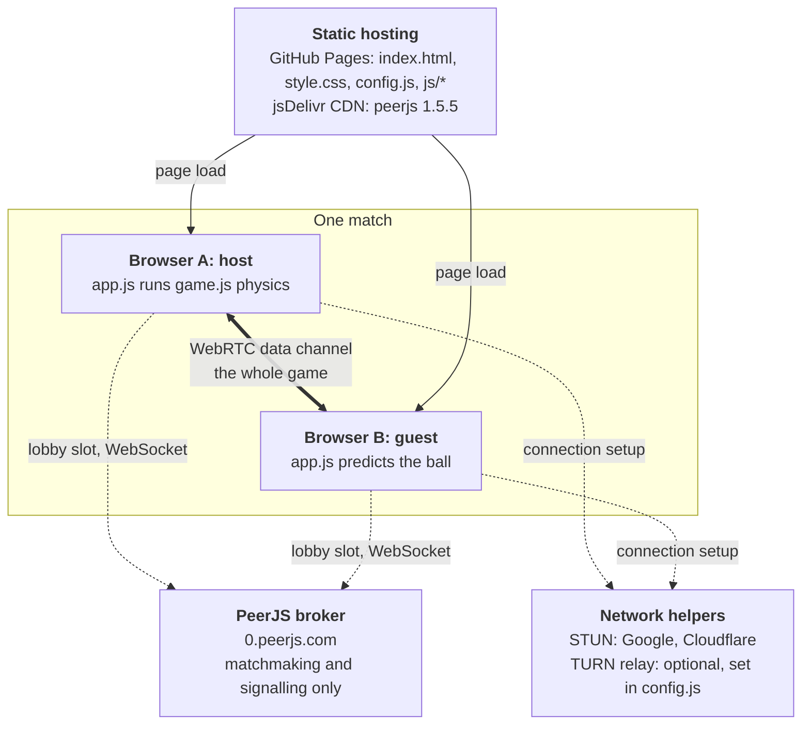
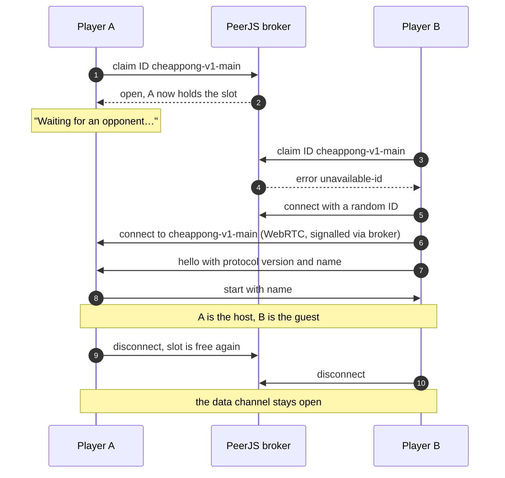
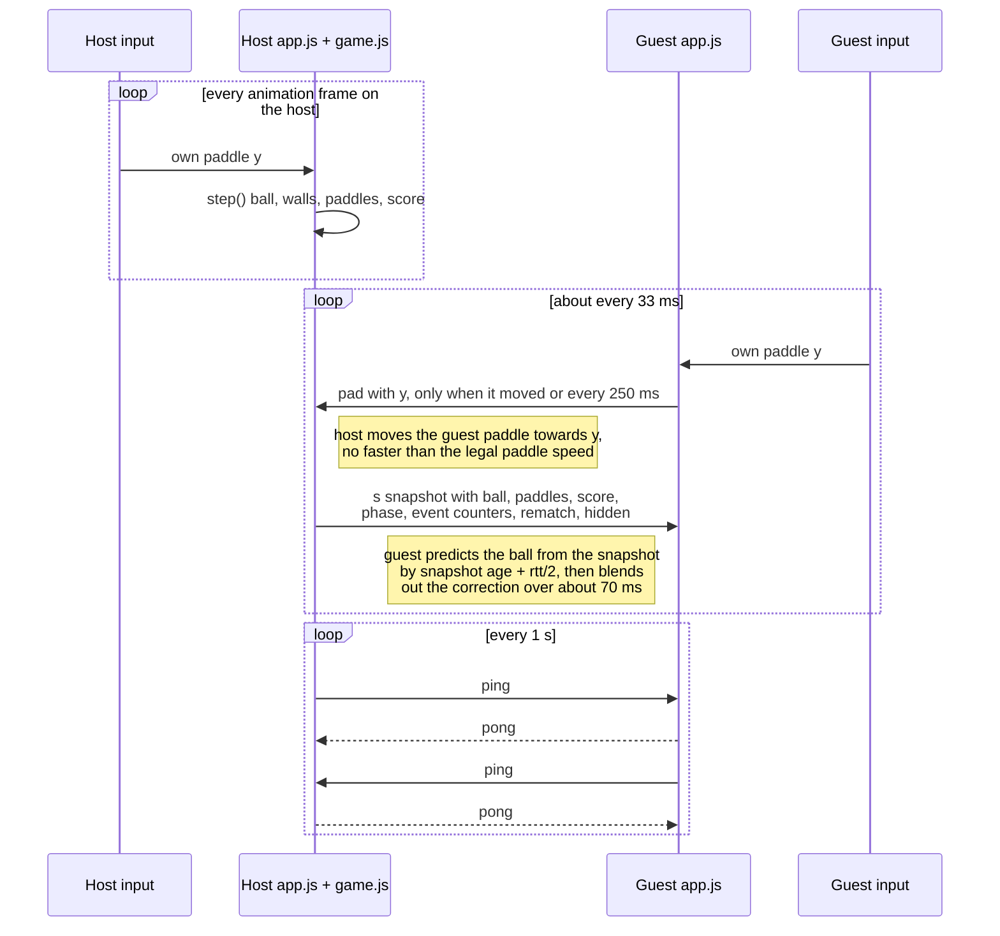
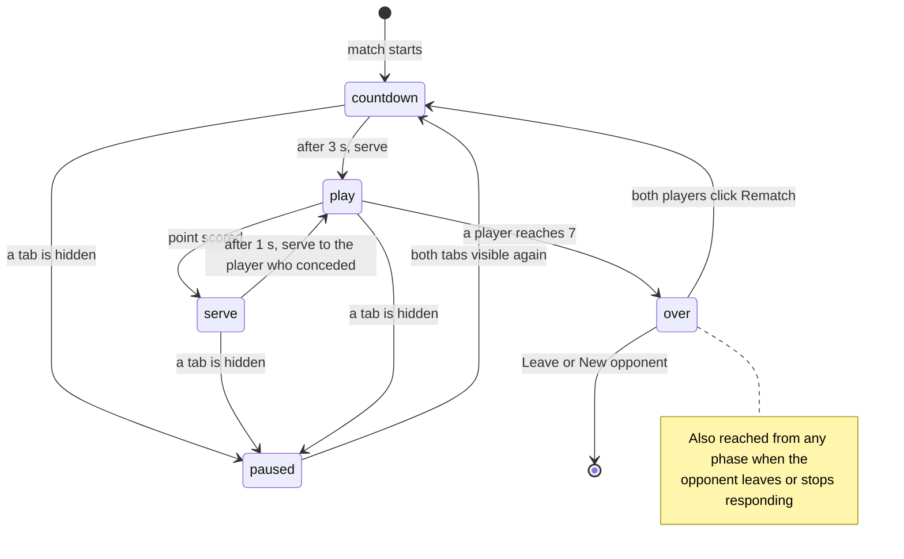
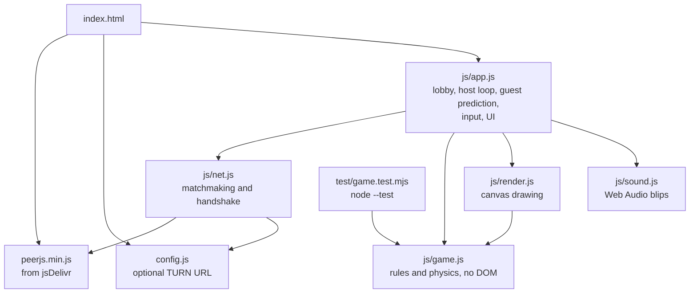

# CheapPong architecture

CheapPong is a static website. There is no game server: GitHub Pages serves the files, a
free public broker introduces the two players, and from then on the two browsers talk
directly to each other over WebRTC. One of them (the host) runs the game.

## 1. System overview

Dotted lines are only used while connecting. Once the data channel is open, both players
leave the broker, so the broker never sees any game traffic and the lobby slot is free for
the next pair. STUN lets each browser find its public address so they can connect
directly. If a network blocks that (strict NATs, many mobile carriers, offices), the game
traffic has to go through a TURN relay; with none configured, those players can't play
each other.

## 2. Matchmaking: the lobby slot

Everyone tries to claim the same peer ID, `cheappong-v1-main` (or `cheappong-v1-<name>`
with `?lobby=<name>`). The broker gives an ID to only one client at a time, so the first
player to arrive waits in the slot and the next one connects to them.

Failure handling in `js/net.js`:

| Situation | What happens |
| --- | --- |
| Slot holder is already mid-handshake with someone else | It answers `busy` and the newcomer retries |
| Slot holder left before the guest connected (`peer-unavailable`) | The guest tries to take the slot itself |
| Handshake doesn't finish within 10 s | Counted as a failed connection; after 2 the status warns that the network may block direct play |
| A host has 2 guests fail in a row | It gives up the slot for 10–15 s so a reachable player can host |
| More than 15 broker errors | Search stops with "Could not reach the matchmaking service" |
| Protocol version mismatch | The host answers `busy`, so old and new versions never pair |

## 3. During a match

The host is the only referee. It reads its own paddle from the mouse/keyboard, takes the
guest's paddle from the network, steps the physics every frame and sends a snapshot about
30 times a second. The guest only sends its paddle position. Both screens are drawn from
each player's own point of view, so the guest's view is mirrored left to right.

Other messages on the same channel:

| Message | From | Meaning |
| --- | --- | --- |
| `vis` | guest | The guest's tab was hidden or shown. The host pauses the match while either tab is hidden and restarts with a countdown. |
| `rematch` | guest | The guest wants a rematch. The host's own wish and the guest's are both shown in the snapshot (`rm`); when both are set the host starts a new match. |
| `bye` | either | The player clicked Leave or closed the page. The other side wins by forfeit. |

If nothing arrives for 15 seconds, the other player is treated as gone. Sounds (paddle,
wall, point) are played on both sides by comparing the event counters in consecutive
states, so the guest hears the same events as the host.

### Match phases

After a pause, a rally that was in flight carries on from where it stopped; if the pause
happened before a serve, the countdown ends with a fresh serve.

## 4. Code layout

`js/game.js` has no DOM or network code, so the same functions run the real match on the
host, predict the ball on the guest, and are unit-tested in Node.

## Design choices

| Choice | Why | Cost |
| --- | --- | --- |
| Peer-to-peer instead of a WebSocket server | Free to run and nothing to operate; GitHub Pages can only serve static files | Some networks block direct connections without a TURN relay |
| Host-authoritative physics | Only one copy of the truth, so the two players can never disagree about a point | The host's own paddle has no network delay, a small advantage |
| Guest-side prediction | Hides the network delay, so the ball moves smoothly between snapshots | On a last-moment save the guest's ball can briefly be wrong before snapping to the host's |
| Fixed 240 Hz physics sub-steps | The ball can't pass through a paddle, even at top speed or after a slow frame | Slightly more work per frame, negligible for one ball |
| Host limits the guest paddle speed | A modified client can't teleport its paddle onto the ball | Some slack is allowed for bunched-up packets |
